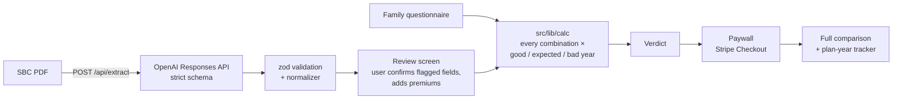

**Which health plan should cover each person in your family?**

MediPlan is a web app for US families choosing employer health insurance
during open enrollment. Upload the plan summaries (SBC PDFs) from one or both
spouses' employers, describe your family, and get the cheapest way to cover
everyone, priced for a good, an expected and a bad year. After enrolling, the
family logs each medical bill and MediPlan checks it against the plan.

- **Live:** https://medi-plan-iota.vercel.app (no account, no sign-up)
- **Built for:** BUSINESS CUP 2.0, Money track, in 24 hours
- **Price:** the answer is free; the full comparison, the bad-year stress test
  and the plan-year tracker are $49 a year

## Contents

- [Try it in two minutes](#try-it-in-two-minutes)
- [The problem](#the-problem)
- [Who it is for](#who-it-is-for)
- [What you get, free and paid](#what-you-get-free-and-paid)
- [A real example](#a-real-example)
- [How it works](#how-it-works)
- [Reading the PDF](#reading-the-pdf)
- [The cost engine](#the-cost-engine)
- [The plan-year tracker](#the-plan-year-tracker)
- [Payments](#payments)
- [Privacy and health data](#privacy-and-health-data)
- [Evidence](#evidence)
- [Market and unit economics](#market-and-unit-economics)
- [API](#api)
- [Project structure](#project-structure)
- [Run it locally](#run-it-locally)
- [Deployment](#deployment)
- [Engineering rules we keep](#engineering-rules-we-keep)
- [Roadmap](#roadmap)
- [Team](#team)
- [Glossary](#glossary)
- [Not insurance or medical advice](#not-insurance-or-medical-advice)

## Try it in two minutes

1. Open https://medi-plan-iota.vercel.app and press **Try with sample plans**.
   Three real 2026 plan documents from Indiana University and the University
   of Kentucky are read live by the same pipeline as an upload (about 15 s
   each). They are labelled as sample data on screen.
2. Check the six key figures of each plan. Only values the model was unsure
   of are highlighted; press **These look right** or edit them.
3. Press **Continue to your family** and answer three short steps: who is
   covered, how much care you expect, and your savings. Skip any question you
   like: every gap becomes a listed assumption.
4. Press **See my best option**. The verdict shows the best way to cover the
   family, its expected yearly cost and how much it saves.
5. To open the full comparison and the plan-year tracker, pay with Stripe's
   test card `4242 4242 4242 4242`, any future date, any CVC and any ZIP. No
   real money moves.

Everything a visitor enters stays in their browser.

## The problem

Every November American workers pick a health plan for the whole next year
and cannot switch until the next open enrollment.

| Fact | Number | Source |
| --- | --- | --- |
| Worker's own yearly share of a family premium | **$7,471**, up 9% in a year | [KFF Employer Health Benefits Survey 2026](https://www.kff.org/other-health/workers-now-pay-7471-on-average-annually-for-family-health-coverage-up-9-or-621-from-2025-benchmark-employer-health-benefits-survey-finds/) |
| Employees who chose a plan another option beat in every scenario | **most** of 23,894 studied | [Bhargava, Loewenstein and Sydnor, QJE 2017](https://www.cmu.edu/dietrich/sds/docs/bhargava/BLS%20QJE%202017_Published.pdf) |
| Excess spending from that choice | **24%** of the chosen plan's premium | same |
| Money at stake per family | **≈ $1,790 a year** (24% × $7,471) | derived, `docs/research/market-and-economics.md` |

Why people get it wrong:

- **The premium is the visible price.** The real yearly cost depends on the
  deductible, copays, coinsurance and out-of-pocket limit, and on how much
  care the family uses. Comparing even two plans means understanding seven
  terms (see the [glossary](#glossary)).
- **Two incomes mean two menus.** When both spouses work, each employer offers
  its own plans, and the family can be split across them: you on one plan, your
  partner and the kids on another. Employer comparison tools (ALEX, Nayya,
  Healthee) are sold to one employer and only see that employer's plans.
- **The bad year is invisible.** A cheap plan can be ruinous if someone ends
  up in hospital. Few people price that before they choose.

## Who it is for

Couples aged 25 to 45 where both partners work, with children or planning
them. There are **30.7 million** married couples in the US where both spouses
work ([BLS, Employment Characteristics of Families 2025](https://www.bls.gov/news.release/famee.t02.htm)).
Single workers with one menu can use MediPlan too: it still prices every plan
for a good, an expected and a bad year.

## What you get, free and paid

| | Free | $49 a year |
| --- | :---: | :---: |
| Read plan PDFs, review and correct the numbers | ✓ | ✓ |
| Family questionnaire | ✓ | ✓ |
| Best way to cover the family, expected yearly cost, yearly saving | ✓ | ✓ |
| Every option side by side | | ✓ |
| Bad-year stress test for each option | | ✓ |
| Plan-year tracker: bills, deductible progress, visit estimate, key dates | | ✓ |

The whole flow up to the verdict stays free, so anyone, including judges,
can see the product work without paying or signing up.

## A real example

This is the product's own output for a couple on the built-in samples
(Indiana University PPO $500 and PPO HDHP, University of Kentucky UK-PPO, 2026
premiums, default answers). Totals include premiums.

| Option | Expected year | Bad year |
| --- | ---: | ---: |
| **You on IU HDHP, partner on UK-PPO** (recommended) | **$2,158** | $5,926 |
| Both on IU HDHP | $2,471 | $6,053 |
| You on IU PPO $500, partner on UK-PPO | $3,620 | $6,642 |
| Both on UK-PPO | $6,216 | $9,238 |
| Both on IU PPO $500 | $7,505 | $9,673 |

Three plans from two employers already give five ways to cover two people.
The best one is **$5,347 a year** cheaper than the worst, and it is a split
that neither employer's own tool would ever show.

## How it works

The model only reads documents. Every decision is plain, tested TypeScript.



| Step | Route | Code |
| --- | --- | --- |
| Landing | `/` | `src/app/page.tsx`, `src/components/landing` |
| Upload, review, premiums | `/start` | `src/components/start`, `src/app/api/extract` |
| Family questionnaire | `/profile` | `src/components/profile` |
| Verdict and comparison | `/result` | `src/components/result`, `src/lib/calc` |
| Plan-year tracker (paid) | `/year` | `src/components/year`, `src/lib/calc/year.ts` |
| Checkout | `/api/checkout` | `src/app/api/checkout`, `src/components/paywall` |

## Reading the PDF

Every US health plan must publish a **Summary of Benefits and Coverage**
(SBC) on the same federal template. That makes it the one document we can
read reliably across employers.

`POST /api/extract` (`src/lib/extract`):

1. **Checks the file:** PDF only, up to 4 MB (`limits.ts`).
2. **Sends it to the OpenAI Responses API** as a base64 `input_file` with
   `responses.parse` and a strict structured-output schema (`schema.ts`).
   The default model is `gpt-6.1-sol`; set `OPENAI_MODEL` to override it.
3. **Asks only for what the document says** (`prompt.ts`): in-network values,
   one row per service with the text as written, the kind of cost (free,
   copay, coinsurance, not covered, not found), the amount, whether the
   deductible applies first, and an `uncertain` flag. When a plan has several
   in-network tiers, the model flags the tier choice once instead of every row.
4. **Validates and normalizes** (`normalize.ts`): zod checks the answer, then
   it is mapped onto the shared `ExtractedPlan` contract
   (`src/lib/domain/plan.ts`). Fields the model was unsure of go into
   `warnings`; fields the document does not contain go into `missing`.
5. **Never guesses.** Missing values stay empty on the review screen for the
   user to fill in. Nothing reaches the cost engine until the user has seen
   the flagged fields.

Every failure has a clear message and a way forward:

| Situation | Status | What the user sees |
| --- | --- | --- |
| Not a PDF / too large | 415 / 413 | Upload a PDF up to 4 MB, or enter the numbers by hand |
| Not an SBC | 422 | Upload the SBC, or enter the numbers by hand |
| Model busy / timed out / unavailable | 503 / 504 / 502 | Try again, or enter the numbers by hand |
| Answer failed validation | 502 | Enter the numbers by hand and continue |

SBCs do not contain premiums, so the review screen asks for the monthly
premium per coverage tier. The sample flow fills them in from each employer's
published rate table (`src/lib/samples.ts`, sources in
`public/samples/SOURCES.md`).

## The cost engine

`src/lib/calc`, entry point `recommend(household, plans, prices)`.
Deterministic, no model calls, covered by unit tests.

- **`cost.ts`**: one event-by-event tracker. It walks through every expected
  medical event and applies deductibles (embedded or aggregate), copays,
  coinsurance, out-of-pocket limits and exclusions, then adds premiums,
  employer HSA money and spousal surcharges.
- **`combinations.ts`**: every way to cover the family across both employers,
  including splitting adults and children between plans.
- **`scenarios.ts`**: a good, an expected and a bad year. The bad year adds an
  ambulance, an emergency room visit and a hospital stay to whoever it would
  cost the most.
- **`index.ts`**: drops any option that another option beats in every
  scenario, then picks the cheapest expected year whose bad-year shock the
  family's savings can absorb. It warns when the whole family depends on one
  job.
- **`sensitivity.ts`**: re-runs the pick with each unanswered question pushed
  to its extremes and marks the assumptions that could change the
  recommendation, so the family knows which questions matter.

Care is priced with a sourced reference table of typical in-network prices
(`src/lib/domain/reference-prices.ts`, details in `docs/research/prices.md`).
13 of 17 prices cite Peterson-KFF, HCCI or FAIR Health claims research; the
other four are labelled **Estimate** on the result screen.

The questionnaire asks how much care the family expects (visits,
prescriptions, planned events such as a birth), never for diagnoses. Every
value is stored as a `Field<T>` with a status: answered, assumed or unknown
(`src/lib/domain/profile.ts`). The result lists every assumption it made.

## The plan-year tracker

`/year` is the reason to come back during the year:

- **Bills:** log a bill or EOB; `year.ts` replays it through the same cost
  tracker to show what the family should owe and flag overcharges.
- **Progress:** how far each person and the family are toward the deductible
  and the out-of-pocket limit.
- **Next visit:** what the next doctor visit or scan will cost at this point
  in the year.
- **Key dates:** FSA/HSA deadlines and the next open enrollment, exportable to
  the family's calendar (`calendar.ts`).

In November new plans and new premiums arrive, the decision has to be made
again, and the subscription renews.

## Payments

- **Stripe Checkout in test mode**, $49 a year, subscription billed once a
  year. Called over Stripe's REST API with `fetch`, no SDK
  (`src/app/api/checkout/stripe.ts`).
- **Only `sk_test_` keys are accepted**, so a live key can never be charged by
  mistake.
- **The server verifies before unlocking.** On return, `GET /api/checkout/verify`
  asks Stripe for the session and accepts it only if it is `complete`, `paid`,
  4900 cents and stamped with our product metadata. Only then does the paywall
  unlock (`src/components/paywall/paywall.tsx`).
- **The test card is on screen:** `4242 4242 4242 4242`, any future date, any
  CVC, any ZIP.
- **Without `STRIPE_SECRET_KEY`** the paywall offers a clearly labelled demo
  unlock instead, so local development never dead-ends.

## Privacy and health data

- No accounts and no database. The session (`plans`, `household`, logged
  bills, paid state) lives in the visitor's browser in `localStorage`
  (`src/lib/store/session.ts`).
- Uploaded PDFs are sent to the model to be read and are not stored by
  MediPlan.
- We ask about the amount of care, never about diagnoses, and we give no
  medical advice.
- Secrets live only in `.env.local` and in Vercel settings.

## Evidence

| Claim | Result | Details |
| --- | --- | --- |
| Extraction accuracy | **30 of 30** hand-checked key values correct across five real SBCs | `docs/research/extraction.md` |
| Extraction speed | **13–17 s** per document | same |
| Flagged fields after the tier fix | 18, down from 37, on the same five documents | same |
| Sourced prices | **13 of 17** services cite claims research | `docs/research/prices.md` |
| Sample documents | Five real, publicly posted 2026 SBCs, unchanged, with source URLs | `public/samples/SOURCES.md` |
| Tests | **63 unit tests** on the engine, sensitivity, tracker, calendar, questionnaire, extraction normalizer, checkout and the landing example | `npm test` |

Accuracy per document (production, 14 November 2026):

| Document | Read in | Checked values correct |
| --- | --- | --- |
| Indiana University, Anthem PPO $500 | 15.8 s | 6 of 6 |
| Indiana University, Anthem PPO HDHP | 13.2 s | 6 of 6 |
| University of Pittsburgh, Panther HDHP | 14.4 s | 6 of 6 |
| University of Kentucky, UK-PPO (three network tiers) | 15.9 s | 6 of 6 |
| Duke University, Duke Plus PPO | 16.9 s | 6 of 6 |

Checked values per plan: individual and family deductible, whether the
deductible is embedded, individual and family out-of-pocket limit, and the
primary care visit.

## Market and unit economics

Every input has a source; every derived number shows its formula in
`docs/research/market-and-economics.md`.

**Market**

| | Value | How |
| --- | --- | --- |
| Americans under 65 on employer coverage | ~157 M | KFF EHBS 2026 |
| Workers who pick a plan every year | 67.6 M | KFF EHBS 2025 |
| **TAM** | **$3.3 B a year** | 67.6 M × $49 |
| **SAM** (dual-earner couples, two menus) | **$1.5 B a year** | 30.7 M × $49 |
| Goal: $100 M ARR | 2.04 M paying families | 6.6% of SAM |

**One paying family**

| | Value |
| --- | --- |
| Price | $49 a year, collected upfront |
| Stripe card and billing fees | −$2.06 |
| Model cost, four SBC reads | −$0.31 (measured: ~21 k input tokens per SBC) |
| **Net per paid year** | **$46.62** |
| First-year renewal | 28% base, 40% target (RevenueCat 2026) |
| **LTV** | **$65–78** |

**Acquisition**

| Channel | CAC | LTV / CAC | Verdict |
| --- | ---: | ---: | --- |
| Organic search and content during open enrollment | $15 | 4.4–5.2× | Main channel |
| Partners (HSA providers, credit unions, finance creators), 30% revenue share | $30 | 2.2–2.6× | Second channel |
| Paid search, $3.39 a click | $176 | 0.4× | Do not buy |

CAC already includes the model cost of free users who never pay. Because the
price is collected upfront, every channel except paid search pays back on the
first purchase.

## API

### `POST /api/extract`

Read one SBC.

- **Request:** `multipart/form-data` with one field `file`, a PDF up to 4 MB.
- **200:** `{ plan: ExtractedPlan, warnings: string[], missing: string[] }`.
  `warnings` and `missing` are field paths such as `deductible.family` or
  `services.imaging`.
- **Errors:** `{ error, message }` with the statuses listed in
  [Reading the PDF](#reading-the-pdf). `500 not_configured` when
  `OPENAI_API_KEY` is not set.

```bash
curl -F "file=@public/samples/iu-anthem-ppo500-2026.pdf;type=application/pdf" \
  http://localhost:3000/api/extract
```

### `GET /api/checkout`

`{ stripe: boolean }`: whether Stripe checkout is configured on this server.

### `POST /api/checkout`

- **Request:** `{ returnPath: "/result" | "/year" | "/pricing" }`.
- **200:** `{ url }`, the Stripe Checkout page to redirect to.
- **Errors:** `400` bad return path, `503` Stripe not configured, `502` Stripe
  error.

### `GET /api/checkout/verify?session_id=cs_test_...`

- **200:** `{ paid: boolean }`, true only for a completed, paid $49 MediPlan
  subscription.
- **Errors:** `400` bad id, `404` unknown session, `503` not configured,
  `502` Stripe error.

## Project structure

```
src/
  app/
    page.tsx                 landing
    start/ profile/ result/ year/
    api/
      extract/route.ts       POST an SBC, get an ExtractedPlan
      checkout/              create and verify Stripe Checkout sessions
  components/
    start/                   upload, review, premiums
    profile/                 three-step family questionnaire
    result/                  verdict, options, scenarios, assumptions, prices
    year/                    bills, deductible progress, visit estimate, dates
    paywall/                 PaidGate, offer, test card
    landing/ ui/             shared visual pieces
  lib/
    domain/                  plan.ts, profile.ts (zod contracts), reference-prices.ts
    extract/                 schema, prompt, OpenAI call, normalizer
    calc/                    cost, combinations, scenarios, recommend, sensitivity, year
    store/                   browser session (localStorage)
    samples.ts               sample plans and their published premiums
    format.ts                money formatting
public/
  samples/                   five real SBC PDFs + SOURCES.md
  brand/                     logo
docs/
  DOMAIN.md                  how US employer insurance works (team cheat sheet)
  research/                  extraction accuracy, reference prices, market and economics
  roles/                     each teammate's brief
```

## Run it locally

Requires Node.js 20.9 or newer.

```bash
git clone https://github.com/Iliyas016/MediPlan.git
cd MediPlan
npm install
cp .env.example .env.local
npm run dev
```

Open http://localhost:3000.

| Variable | Required | What it does |
| --- | --- | --- |
| `OPENAI_API_KEY` | For PDF reading | Without it, upload returns a clear error and the user can enter numbers by hand |
| `OPENAI_MODEL` | No | Overrides the default extraction model `gpt-6.1-sol` |
| `STRIPE_SECRET_KEY` | No | A test-mode key (`sk_test_...`). Without it the paywall offers a labelled demo unlock |

Checks (run before every push):

```bash
npm test
npm run typecheck
npm run lint
```

## Deployment

`main` deploys to Vercel automatically at
https://medi-plan-iota.vercel.app. The same environment variables are set in
the Vercel project settings. `/api/extract` runs with `maxDuration = 120` so
long documents finish reading.

## Engineering rules we keep

- **No hardcoded results.** Every number on screen comes from the uploaded
  documents, the user's answers or a sourced reference table. Test fixtures
  live only in `*.test.ts` files.
- **The model only extracts.** All cost math is deterministic TypeScript in
  `src/lib/calc`, covered by tests.
- **Sample plans go through the live pipeline** and are labelled as samples.
- **Every failure path is handled:** bad file, model error, empty state. The
  user always sees what went wrong and what to do next.
- **No dead buttons.** What does not work yet is hidden.
- **Works at 375 px** wide.

## Roadmap

- Read premiums straight from the employer's enrollment guide.
- Log a bill from a photo of the insurer's EOB.
- Check provider networks and drug lists for the family's doctors and
  prescriptions.
- Source the four remaining estimated prices (specialty and non-preferred
  drugs, therapy, physical therapy).
- A reminder before the next open enrollment, with last year's bills already
  in place.

## Team

| | Role |
| --- | --- |
| **Ilyas** | Cost engine, questionnaire, result and tracker screens, design system, deployment |
| **Abylaikhan** | PDF extraction with the OpenAI API, upload and review screen, Stripe paywall |
| **Aibyn** | Sample documents and sources, market and price research, design |

## Glossary

| Term | Meaning |
| --- | --- |
| Open enrollment | The yearly window, usually November, to choose next year's plan |
| Premium | The monthly price of the plan; the worker's share comes out of the paycheck |
| Deductible | What you pay in full each year before the plan starts paying |
| Copay | A fixed fee per visit, for example $30 for a doctor visit |
| Coinsurance | The share you pay after the deductible, for example 20% |
| Out-of-pocket maximum | The most you pay in a year; above it the plan pays everything |
| Embedded deductible | On a family plan, no one person pays more than the individual deductible |
| HDHP | High-deductible health plan: cheaper premium, higher deductible |
| HSA | A pre-tax savings account for medical costs, available with an HDHP |
| Spousal surcharge | Extra charge for covering a spouse who has their own employer's plan |
| SBC | Summary of Benefits and Coverage, the standard federal plan summary |
| EOB | Explanation of Benefits, the insurer's statement after a visit |

## Not insurance or medical advice

MediPlan compares costs from the documents and answers it is given. It does
not yet check provider networks or drug lists, it gives no medical advice,
and it is not a licensed insurance broker.
